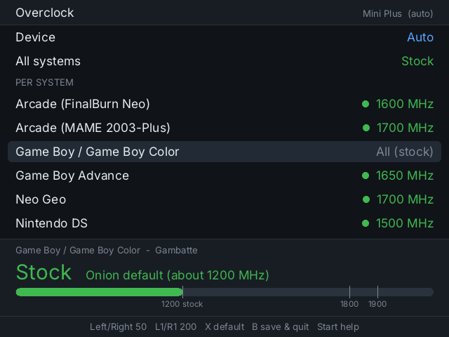
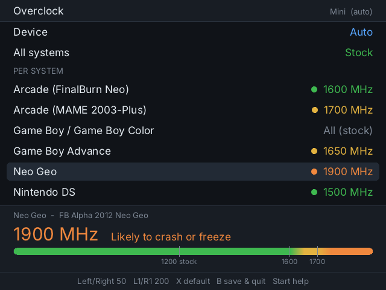
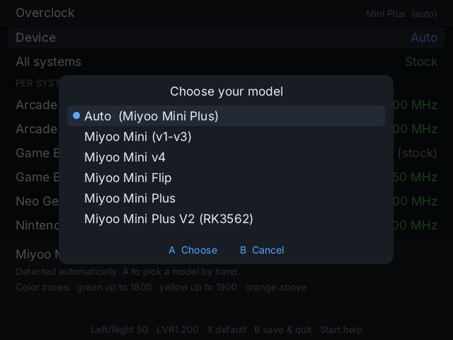
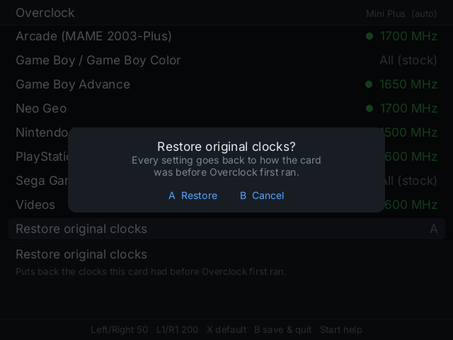
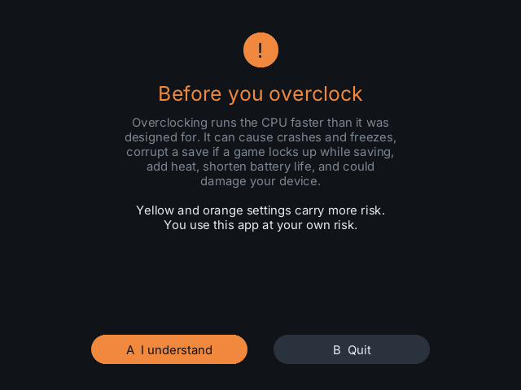
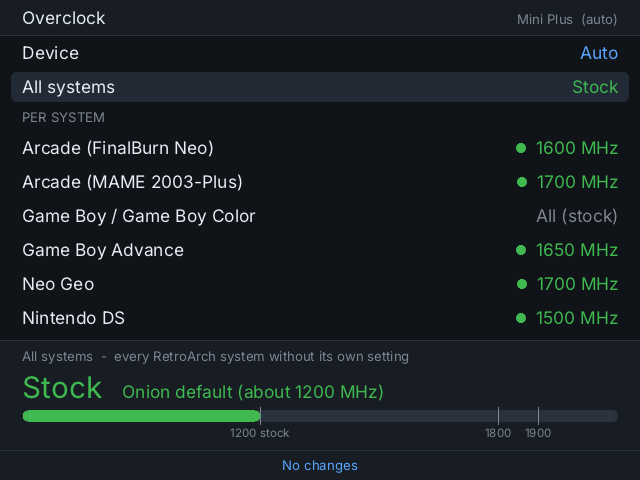
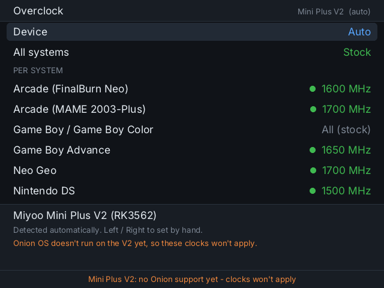

# Overclock for Miyoo Mini

A CPU clock app for **Onion OS on the Miyoo Mini, Mini v4 and Mini Plus**. Set one clock for every system, or a different clock per system, with color zones that warn you before you push too far.



> **⚠ Overclocking runs the CPU faster than it was designed for.** It can cause crashes and freezes, corrupt a save if a game locks up while saving, add heat, shorten battery life, and could damage your device. You use this app at your own risk. The app shows this warning the first time it opens.

## Features

- **All systems:** one clock for every RetroArch system that doesn't have its own setting.
- **Per system:** each system can follow "All systems" or have its own clock.
  - Only systems with games on your card are listed.
  - Systems that share an emulator share a row (e.g. Genesis / Master System / Game Gear).
  - A system whose launcher can pick between emulators gets a row for each, e.g. **Arcade (MAME 2003-Plus)** and **Arcade (FinalBurn Neo)**.
- **DS and other non-RetroArch systems** that set their own clock in `launch.sh` (such as Drastic's `cpuclock 1500`) are listed too. The app edits that number.
- **Automatic model detection.** To set it by hand, press A on **Device** and pick from the list: Mini (v1–v3), Mini v4, Mini Flip, Mini Plus or Mini Plus V2 (see [Compatibility](#compatibility)).
- **Color zones:** the value, a dot and a gauge shift from green to yellow to orange as you go up.
- **Restore original clocks:** the first launch saves every clock your card already had, and one option puts them all back. A system's `launch.sh` is also backed up before its first edit.

| Likely to crash | Model detection | Restore |
|---|---|---|
|  |  |  |

| First-run warning | Controls | Mini Plus V2 |
|---|---|---|
|  |  |  |

## Color zones

The zones follow the limits in the [Onion OS FAQ](https://onionui.github.io/docs/faq):

| Model | Green (recommended) | Yellow (Onion's max stable) | Orange (likely to crash) |
|---|---|---|---|
| Mini v1–v4 | up to 1600 MHz | 1650–1700 | above 1700 |
| Mini Plus, Mini Flip | up to 1800 MHz | 1850–1900 | above 1900 |

Chips vary from unit to unit. One Mini v3 tested here froze in Neo Geo games at 1700 MHz but ran everything at 1600. If a game freezes, hold Power to restart, then lower that system's clock.

There's no official per-system table. As a rough guide, light systems (NES, Game Boy, SNES, Genesis) don't need an overclock, while GBA, arcade, Neo Geo, PlayStation and Saturn can benefit. Onion's FAQ uses PlayStation at 1600 as its example.

## Install

1. Download `Overclock-x.y.z.zip` from [Releases](../../releases).
2. Extract it to the **root of your SD card**. You'll get `App/Overclock/`.
3. On the Miyoo, open **Apps → Overclock**.

## Controls

| Button | Action |
|---|---|
| Up / Down | Choose a setting |
| Left / Right | Change by 50 MHz (hold to repeat) |
| L1 / R1 | Change by 200 MHz |
| X | Back to default (All systems, or stock for the All systems row) |
| A | On **Device**: pick your model from a list. On **Restore original clocks**: put the card's original clocks back |
| B or Menu | Save and quit |
| Select | Quit without saving |
| Start | Controls help |

New clocks apply the next time a game starts.

## How it works

It writes the same files Onion's RetroArch already reads when a game starts:

| Setting | File |
|---|---|
| Per system | `Saves/CurrentProfile/config/<core>/cpuclock.txt` (also `config_v4/<core>/` if your card uses it) |
| All systems | `RetroArch/cpuclock.txt`, the fallback RetroArch uses when a core has no file of its own |
| Stock | no file: RetroArch runs at its default speed (about 1200 MHz) |

So the clocks keep working even if you remove the app. Nothing else on the card is changed, apart from the `cpuclock` number in a non-RetroArch system's `launch.sh`.

## Compatibility

- Tested on the **Miyoo Mini Plus** with Onion OS.
- The Mini (v1–v3) and Mini v4 are detected and use the Mini zones. The v4's 752×560 screen is supported in layout, but hasn't been tested on hardware yet.
- **Mini Flip** (Onion's Flip build, model 285): detected automatically and given the Mini Plus zones, since Onion's Flip build allows the same 1800 MHz as the Plus. It has the same chip as the other Minis, but hasn't been tested on a Flip yet.
- **Mini Plus V2** (Rockchip RK3562): the app recognizes it, but Onion OS doesn't run on it yet, so its clocks won't apply. It says so on screen.

## Theme icons

The app ships with a white line icon. Matching icons for **Analogue**, **Hello Miyoo** and **NEON.ion** are in [`extras/theme-icons`](extras/theme-icons). To install one, copy that theme's `icons/app/overclock.png` into the matching folder under `Themes/` on your card.

## Building

This needs [Zig 0.14](https://ziglang.org/download/), which cross-compiles a static ARM binary with no Miyoo toolchain.

```powershell
.\build.ps1 -Version 1.0.0            # app\Overclock\overclock + dist\Overclock-1.0.0.zip
.\build.ps1 -Version 1.0.0 -Preview   # also overclock_preview.exe
```

`overclock_preview.exe` runs the same code on a PC against a copy of an SD card. Run it from inside `app\Overclock` with the card folder in `SDROOT` and button names as arguments, e.g. `$env:SDROOT='E:'; ..\..\overclock_preview.exe a down right select`. It writes one PNG per button press to `frames\`. Select quits without saving, so the card isn't changed.

## Credits

- Font: [Inter](https://github.com/rsms/inter), SIL Open Font License 1.1.
- [stb_truetype / stb_image_write](https://github.com/nothings/stb) by Sean Barrett, public domain / MIT.
- Clock limits and file locations from [Onion OS](https://github.com/OnionUI/Onion) and its [RetroArch fork](https://github.com/OnionUI/RetroArch).
- Companion app: [Bible for Miyoo Mini](https://github.com/retroshelf64nmore/miyoo-bible).

## License

The MIT license covers the app's code; see [LICENSE](LICENSE). The bundled font keeps its own license.
